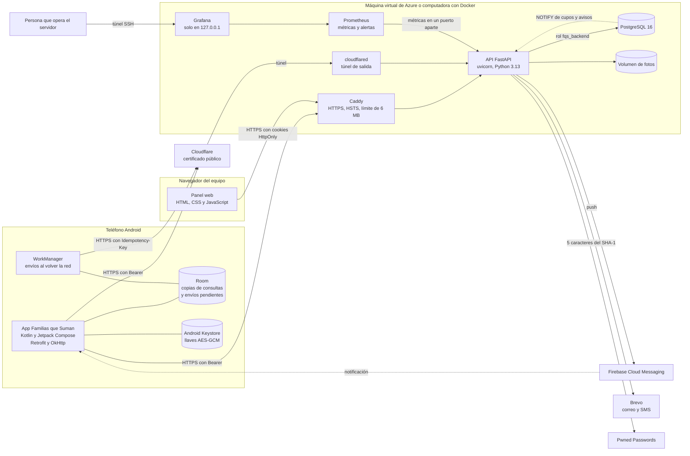
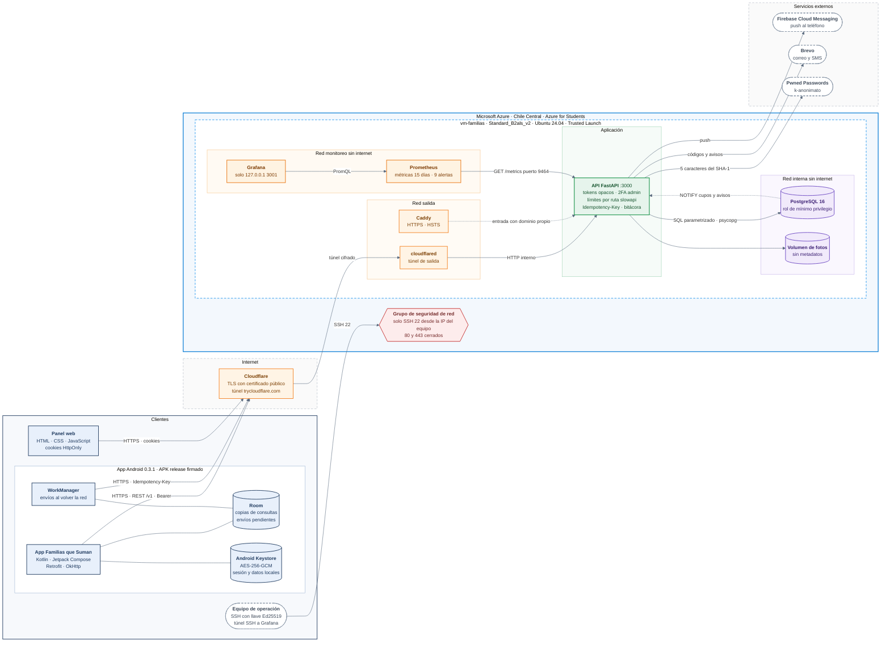

# Arquitectura del sistema

Familias que Suman tiene tres piezas que se comunican solo por HTTPS. La app Android la usan las familias, el panel web lo usa el equipo de la organización, y las dos consumen la misma API. La API es la única que habla con la base de datos. El servidor puede ser cualquier máquina con Docker. El despliegue actual es una máquina virtual de Azure en Chile Central (ver [../seguridad/despliegue-azure.md](../seguridad/despliegue-azure.md)).

## Capas de la app Android

| Capa | Contenido | Archivos principales |
|---|---|---|
| Interfaz | Pantallas de Jetpack Compose (inicio, explorar, actividad, campaña, proyecto, comunidad, historial, propuestas, notificaciones, perfil, privacidad, sesiones, seguridad de administración) | `ui/screens`, `ui/components` |
| Estado | `AppViewModel` pide datos al repositorio y expone el estado de cada pantalla (cargando, listo, error con reintento) | `viewmodel` |
| Datos | Repositorio único, cliente HTTP con Retrofit y OkHttp, modelos y mapeos del JSON de la API, flujo de cupos en tiempo real | `data/Repositorio.kt`, `data/remote` |
| Sesión | Tokens guardados cifrados con AES-GCM y una llave del Android Keystore, renovación automática al recibir 401 | `data/sesion` |
| Sin conexión | Room guarda cifrada la última respuesta de cada consulta y la cola de envíos pendientes. WorkManager manda la cola cuando vuelve la red, cada envío con su clave de idempotencia | `data/local` |
| Dispositivo | Cámara y galería para fotos, notificaciones push, llamada, WhatsApp, correo y mapas con intents del sistema | `data/Imagenes.kt`, `push` |

## Capas de la API

| Capa | Responsabilidad | Carpeta |
|---|---|---|
| Entrada HTTP | Middleware propio que pone el id de petición, calcula la IP real, agrega los encabezados de seguridad, limita el tamaño del cuerpo y exige `application/json` | `fqs/http/middleware.py` |
| Autenticación y acceso | Lee la sesión (Bearer o cookie del panel), revisa CSRF en el panel, y las dependencias `Usuario` y `Admin` exigen el nivel de cada ruta | `fqs/http/dependencias.py`, `fqs/http/cookies.py` |
| Límites | Decoradores de slowapi en cada ruta sensible y límites por cuenta | `fqs/limites.py` |
| Validación | Modelos estrictos de Pydantic, parámetros de ruta solo UUID | `fqs/validacion.py`, cada módulo de `fqs/rutas` |
| Rutas | Un módulo por área de negocio | `fqs/rutas` |
| Seguridad | Contraseñas, sesiones, segundo factor, bitácora, imágenes, QR, contraseñas filtradas | `fqs/seguridad` |
| Servicios | Base de datos, correo, SMS, push, almacenamiento de fotos, cupos en tiempo real, vigilancia de la bitácora | `fqs/db.py`, `fqs/correo.py`, `fqs/sms.py`, `fqs/push.py`, `fqs/almacen.py`, `fqs/tiempo_real.py`, `fqs/vigilancia.py` |
| Errores | Una sola forma de error para toda la API, traducción de errores de PostgreSQL | `fqs/http/manejo_errores.py`, `fqs/errores.py` |
| Métricas | Contadores e histogramas por plantilla de ruta, inicios de sesión y eventos de seguridad, servidos en un puerto que no es el de la API | `fqs/metricas.py` |

## Capa de datos

PostgreSQL 16 guarda todo en el schema `fqs`. Además de las tablas, la base tiene las reglas que no se pueden saltar aunque falle el backend.

- Cupos, edad mínima y dueño de los acompañantes se revisan en funciones y triggers dentro de la misma transacción de la inscripción.
- Las transiciones de estado de propuestas, testimonios y entregas se validan con triggers.
- La bitácora de seguridad es de solo agregar, cada fila lleva el hash de la anterior.
- Los avisos (recordatorios, sugerencias, favoritos, encuestas) se generan con funciones SQL y se anuncian con `NOTIFY`.
- La API se conecta con un rol del grupo `fqs_backend`, que no puede cambiar el esquema ni borrar la bitácora.

Los scripts están en `db/` del 01 al 10 y se aplican en orden.

## Flujo de una petición

1. La app manda la petición por HTTPS con su token en `Authorization`.
2. Caddy (o el túnel) termina TLS y pasa la petición a la API con la IP real en `X-Forwarded-For`.
3. El middleware asigna un id, revisa tamaño y tipo de contenido.
4. FastAPI resuelve la ruta. La dependencia de sesión busca el SHA-256 del token en la tabla `sesiones`.
5. Si la ruta tiene límite, slowapi cuenta la petición y responde 429 si se pasó.
6. Pydantic valida el cuerpo. Un campo de más o de otro tipo responde 400.
7. La ruta consulta PostgreSQL con parámetros. Las reglas de negocio críticas las aplica la base.
8. La respuesta sale con CSP, `nosniff`, `no-store` y HSTS, queda una línea en el log con la ruta, el estado y el tiempo, y se suman las métricas de esa plantilla de ruta.

## Tiempo real y notificaciones

Cuando cambian los lugares de una actividad, un trigger hace `NOTIFY fqs_cupos`. Una sola conexión de la API escucha ese canal y reenvía el cambio a las apps conectadas por Server-Sent Events (`GET /v1/cupos/stream`). Cuando se crea una notificación, otro trigger hace `NOTIFY fqs_notificaciones` y la API la manda por Firebase Cloud Messaging al teléfono.

## Monitoreo

La API publica métricas en el puerto 9464, que solo escucha en la red interna `monitoreo`. Prometheus las lee cada 15 segundos, las guarda 15 días y evalúa 9 reglas de alerta (API caída, errores 5xx, latencia, ráfagas de 429, inicios de sesión fallidos, fallos de administración, accesos denegados, reuso de refresh tokens y fallas al escribir la bitácora). Grafana consulta a Prometheus por la misma red y muestra el tablero, publicado solo en 127.0.0.1 del servidor. Ver [../seguridad/monitoreo.md](../seguridad/monitoreo.md).

## Uso sin conexión

Cada consulta que llega bien del backend se guarda en Room, cifrada con una llave del Android Keystore distinta de la de la sesión. Si después no hay red, la pantalla muestra esa copia y un aviso al pie con la hora en que se guardó y un botón para reintentar. Un error del servidor (por ejemplo 401 o 404) nunca se tapa con la copia.

Las escrituras que no compiten por un recurso limitado se pueden hacer sin conexión. Son favoritos, avisos de una asociación, me gusta y no me gusta, propuestas, reportes y testimonios con su foto. Si fallan por falta de red se guardan en una cola (las fotos cifradas en una carpeta que no se respalda), la acción se da por hecha y el aviso al pie dice cuántos envíos esperan. WorkManager los manda en orden cuando hay red, aunque la app esté cerrada o el teléfono se haya reiniciado, con espera exponencial si el servidor no responde.

Cada envío lleva una clave de idempotencia que se genera una sola vez. Si la respuesta se pierde en el camino y se reintenta, la API devuelve la respuesta original en lugar de crear otra propuesta o reporte (`fqs/idempotencia.py`, tabla `idempotencia` de `db/10_idempotencia.sql`). Si el servidor rechaza un envío (por ejemplo calificar una actividad a la que no se asistió), el aviso al pie muestra su mensaje.

Inscribirse, cancelar y registrar entregas siempre necesitan conexión, porque dependen de los lugares y de las campañas activas en ese momento. Al cerrar sesión, al expirar la sesión o al pedir la eliminación de la cuenta se borra todo lo guardado en el teléfono.

## Despliegue actual

El sistema corre en una máquina virtual de Azure en Chile Central. La app y el panel entran por el túnel de Cloudflare, la máquina solo acepta SSH desde la IP del equipo, y cada servicio está en la red de Docker que necesita. La imagen está en [arquitectura-despliegue.png](arquitectura-despliegue.png).

