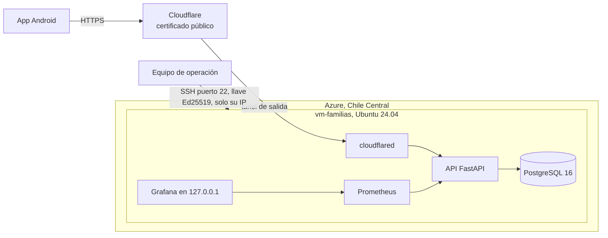

# Despliegue en Microsoft Azure

El sistema completo (PostgreSQL, API, Caddy, Prometheus, Grafana y el túnel de Cloudflare) corre con el mismo `docker-compose.yml` en una máquina virtual de Azure con Ubuntu 24.04 en la región Chile Central (`chilecentral`, Santiago). La app del teléfono llega a la API por el túnel, así que la máquina no abre ningún puerto web hacia internet.

**Por qué Chile.** La suscripción Azure for Students solo permite crear recursos en cinco regiones (`norwayeast`, `francecentral`, `chilecentral`, `canadacentral` y `brazilsouth`), lo que se ve con `az policy assignment list --query "[].parameters"`. Canadá solo ofrecía tamaños ARM, Brasil solo la serie D v7, y Chile tenía la serie B x86, la más económica. Mexico Central no se pudo usar con esa suscripción. Los datos personales quedan alojados fuera de México, así que el aviso de privacidad debe informar esa transferencia internacional (LFPDPPP). Con una suscripción de pago a nombre de la organización se puede crear en `mexicocentral` con el mismo script.



## Qué crea el script

`despliegue/azure/crear-vm.sh` (Linux o Mac) y `despliegue/azure/crear-vm.ps1` (Windows) usan Azure CLI y dejan todo listo en unos minutos.

| Recurso | Configuración |
|---|---|
| Grupo de recursos | `rg-familiasquesuman` en `chilecentral`, con la etiqueta `proyecto=familiasquesuman` |
| Máquina virtual | `vm-familias`, `Standard_B2als_v2` (2 vCPU AMD y 4 GiB), Ubuntu 24.04 LTS (`Canonical:ubuntu-24_04-lts:server:latest`), disco de 64 GB |
| Arranque seguro | Trusted Launch con Secure Boot y vTPM |
| Acceso | Solo llave SSH Ed25519, sin contraseña. Azure acepta llaves Ed25519 en máquinas Linux |
| Grupo de seguridad de red | Todo cerrado. Solo el puerto 22 desde la IP pública de quien corre el script. 80 y 443 cerrados porque la entrada es el túnel |
| Configuración inicial | `despliegue/azure/cloud-init.yaml` |

La configuración inicial hace lo siguiente.

- Actualiza el sistema y deja activas las actualizaciones de seguridad automáticas diarias.
- SSH solo con llave, sin root, con 3 intentos por conexión y fail2ban contra fuerza bruta.
- Firewall del sistema (ufw) que solo deja entrar SSH, además del grupo de seguridad de Azure.
- Docker y Docker Compose desde el repositorio oficial de Docker, con `no-new-privileges` para todos los contenedores, rotación de logs y `live-restore`.
- Carpeta `/opt/familiasquesuman` solo para la cuenta de administración.

Los puertos que Docker publica no pasan por ufw. Por eso Grafana se publica solo en 127.0.0.1 y el control real de lo que entra desde internet es el grupo de seguridad de Azure, que no abre 80 ni 443.

## Pasos

1. Instalar Azure CLI e iniciar sesión con la suscripción del equipo.

```bash
az login
```

2. Crear la llave SSH Ed25519 si no existe. La llave privada nunca sale de la computadora de quien administra.

```bash
ssh-keygen -t ed25519 -a 100 -f ~/.ssh/id_ed25519 -C fqs-azure
```

3. Crear la máquina. Si el tamaño no está disponible en la región para la suscripción, el script lo dice y se puede usar otro con `TAMANO=Standard_B2ms`.

```bash
bash despliegue/azure/crear-vm.sh
ssh fqsadmin@IP_DE_LA_MAQUINA cloud-init status --wait
```

En Windows, desde PowerShell en la carpeta del proyecto.

```powershell
powershell -ExecutionPolicy Bypass -File despliegue\azure\crear-vm.ps1
ssh fqsadmin@IP_DE_LA_MAQUINA cloud-init status --wait
```

Las suscripciones de Azure for Students solo permiten algunas regiones. Si Azure responde que la región no está permitida (`RequestDisallowedByAzure` o `RequestDisallowedByPolicy`), se vuelve a correr con otra región de las permitidas, por ejemplo `-Ubicacion southcentralus` en Windows o `UBICACION=southcentralus` en Linux.

4. Copiar el proyecto a la máquina. El zip no lleva `.env`, secretos ni el archivo de Firebase.

```bash
scp fqs-backend.zip fqsadmin@IP_DE_LA_MAQUINA:/opt/familiasquesuman/
ssh fqsadmin@IP_DE_LA_MAQUINA
cd /opt/familiasquesuman && unzip fqs-backend.zip && cd fqs-backend
```

5. Llenar `.env.docker` en la máquina, como en [despliegue.md](despliegue.md). Las claves se generan ahí mismo con `openssl rand -base64 32` y se guarda una copia fuera del servidor. Con el túnel se deja `FQS_DOMINIO=localhost`, Caddy sigue corriendo pero ningún puerto suyo está abierto en Azure.

```bash
cp .env.docker.example .env.docker
chmod 600 .env.docker
nano .env.docker
```

6. Copiar el archivo de Firebase desde la computadora de quien administra, directo a la carpeta de secretos.

```bash
scp firebase-cuenta-servicio.json fqsadmin@IP_DE_LA_MAQUINA:/opt/familiasquesuman/fqs-backend/docker/secretos/
```

7. En Cloudflare, en Zero Trust, Networks, Tunnels, crear el túnel, apuntar el nombre público (por ejemplo `api.tu-dominio.mx`) a `http://api:3000` y poner el token en `CLOUDFLARE_TUNNEL_TOKEN`.
   Sin dominio se salta este paso y en el siguiente se usa `--profile tunel-rapido` en lugar de `--profile tunel`. La dirección `https://algo.trycloudflare.com` sale con `docker compose --env-file .env.docker logs tunel-rapido` y cambia si se reinicia ese servicio (ver [despliegue.md](despliegue.md), túnel rápido).
8. Levantar todo con el perfil del túnel.

```bash
docker compose --env-file .env.docker --profile tunel up -d --build
docker compose --env-file .env.docker exec api python -m fqs.scripts.crear_admin
```

9. Comprobar desde un teléfono con datos móviles que `https://api.tu-dominio.mx/v1/salud` responde `{"ok":true}` y compilar el APK release con esa dirección en `fqs.api.release`.

## Operación

| Tarea | Cómo |
|---|---|
| Ver Grafana | `ssh -L 3001:127.0.0.1:3001 fqsadmin@IP_DE_LA_MAQUINA` y abrir http://127.0.0.1:3001 en la computadora local |
| Respaldo diario | El mismo crontab de [despliegue.md](despliegue.md) en la máquina, y copiar `respaldos/` fuera de Azure (van cifrados) |
| Correos de Brevo | Autorizar la IP pública de la máquina en Brevo, Security, Authorised IPs. Es la misma que da `az vm show -d -g rg-familiasquesuman -n vm-familias --query publicIps -o tsv` |
| Cambió la IP de quien administra | `az network nsg rule update -g rg-familiasquesuman --nsg-name nsg-vm-familias -n ssh-administracion --source-address-prefixes NUEVA_IP/32` |
| Detener la máquina sin borrarla (deja de cobrar cómputo) | `az vm deallocate -g rg-familiasquesuman -n vm-familias` |
| Volver a encenderla | `az vm start -g rg-familiasquesuman -n vm-familias`. Docker levanta los contenedores solo |
| Borrar todo al terminar el proyecto | `az group delete -n rg-familiasquesuman` después de sacar un respaldo |

Los discos administrados de Azure se cifran en reposo por omisión. Aun así, los datos que importan (respaldos, secretos del segundo factor) ya van cifrados por la aplicación con claves que Azure no tiene.

## Referencias

- Microsoft, tipos de llave SSH aceptados en máquinas Linux de Azure (incluye Ed25519). https://learn.microsoft.com/azure/virtual-machines/linux/create-ssh-keys-detailed
- Canonical, nombres de las imágenes de Ubuntu en Azure. https://documentation.ubuntu.com/azure/azure-how-to/instances/find-ubuntu-images/
- Docker, instalación en Ubuntu desde el repositorio oficial. https://docs.docker.com/engine/install/ubuntu/
