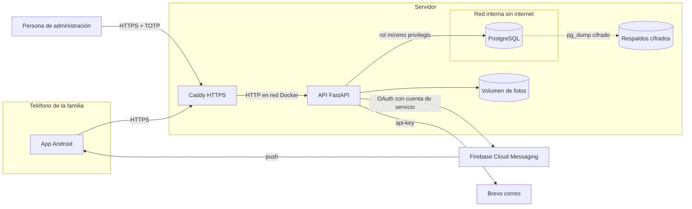

# Modelo de amenazas STRIDE

STRIDE agrupa las amenazas en seis tipos, suplantación (Spoofing), alteración (Tampering), repudio (Repudiation), divulgación de información (Information disclosure), denegación de servicio (Denial of service) y elevación de privilegios (Elevation of privilege). Para cada amenaza se indica el control que la atiende y dónde se comprueba. Los identificadores T-xx se usan también en la [matriz de riesgos](matriz-riesgos.md).

## Sistema analizado

### Activos
| Activo | Por qué importa |
|---|---|
| Datos personales de familias (nombre, correo, teléfono, fecha de nacimiento, acompañantes, incluidos menores) | Protegidos por la LFPDPPP, su filtración daña a personas reales |
| Fotos subidas | Pueden mostrar rostros de menores y ubicaciones |
| Credenciales y sesiones | Dan acceso a todo lo anterior |
| Cuentas de administración | Pueden publicar contenido, ver participantes, suspender cuentas y anonimizar datos |
| Integridad de cupos, asistencias y valoraciones | La confianza de las asociaciones depende de que sean reales |
| Bitácora de seguridad | Es la evidencia de lo que pasó si hay un incidente |
| Secretos del servidor (cuenta de Firebase, llave de Brevo, claves de cifrado) | Permiten suplantar al sistema ante terceros o abrir datos cifrados |

### Fronteras de confianza
1. Internet hacia Caddy. Todo lo que llega aquí es no confiable.
2. Caddy hacia la API. Solo Caddy puede hablar con la API y es quien fija la IP real del cliente.
3. API hacia PostgreSQL. La API usa un rol que no puede cambiar el esquema ni editar la bitácora.
4. API hacia terceros (Firebase y Brevo). Se autentica con credenciales que viven fuera del repositorio.
5. Teléfono. Un teléfono puede perderse, tener malware o ser revisado por otra persona.
6. Navegador del equipo de administración. El panel web corre en un navegador que también visita otros sitios, que pueden intentar usar su sesión.

## Amenazas y controles

### Suplantación

| Id | Amenaza | Control | Evidencia |
|---|---|---|---|
| T-01 | Adivinar contraseñas por fuerza bruta | 5 intentos fallidos por cuenta bloquean 15 minutos, 20 por IP, scrypt hace costoso cada intento | Prueba de bloqueo tras 5 fallos |
| T-02 | Relleno de credenciales filtradas de otros sitios contra cuentas de administración | Segundo factor obligatorio, contraseña de administración de 14 caracteres o más, intentos fallidos en la bitácora | Pruebas del bloque de segundo factor |
| T-03 | Robo de un refresh token (copia de respaldo del teléfono, malware) | Rotación en cada uso, reuso revoca toda la familia de sesiones, token cifrado con Keystore | Prueba de rotación y reuso, evento `refresh_reutilizado` |
| T-04 | Reusar un código TOTP visto por encima del hombro | El paso ya aceptado se guarda y un código igual o anterior se rechaza | Prueba de código repetido |
| T-05 | Adivinar el código de recuperación de 8 dígitos | Un solo uso, vence en 30 minutos, 5 intentos por cuenta cada 15 minutos | Prueba de recuperación |
| T-06 | Falsificar `X-Forwarded-For` para evadir límites por IP | La API solo confía en el número de proxies configurado y Caddy reemplaza el encabezado | [evidencia/https-caddy.txt](evidencia/https-caddy.txt) |
| T-34 | Registrar o poner en otra cuenta el correo de alguien más para apartarlo o recibir sus códigos | La cuenta se crea y el cambio se aplica solo con el código que llega a ese correo, la recuperación solo va a correos verificados | Pruebas de verificación de correo |
| T-35 | Contraseña reutilizada de una filtración de otro sitio | Se rechaza si aparece en Pwned Passwords | Prueba de contraseñas filtradas |
| T-42 | Registrar el teléfono de otra persona | Registro y cambio de teléfono solo con el código que llega por SMS, formato único para que un número no cuente dos veces | Pruebas de SMS |
| T-36 | Sesión abierta en un teléfono perdido o prestado | La persona la ve y la cierra desde Mis dispositivos, la de administración caduca sola en 30 minutos sin uso | Pruebas de sesiones |
| T-07 | Servidor falso en una red Wi-Fi pública | HTTPS obligatorio, solo CA del sistema, fijación de certificado opcional | network_security_config, ClienteHttp |
| T-45 | Usar las inscripciones para mandar correos de la organización a direcciones ajenas | Solo a acompañantes adultos, solo el nombre de quien inscribe, máximo 30 correos por titular al día | Prueba de correos a acompañantes |

### Alteración

| Id | Amenaza | Control | Evidencia |
|---|---|---|---|
| T-08 | Inyección SQL en búsquedas, filtros o cuerpos JSON | Consultas parametrizadas, parámetros de ruta solo UUID, modelos estrictos de Pydantic | sqlmap sin hallazgos, prueba de búsqueda segura |
| T-09 | Asignación masiva, mandar `rol` o `estado` en el cuerpo | Esquemas estrictos que rechazan campos no declarados | Prueba de asignación masiva |
| T-10 | Inscribirse dos veces al último lugar al mismo tiempo | Bloqueo de fila en la función `inscribir_familia` | Prueba de concurrencia del último lugar |
| T-11 | Valorar o contestar encuestas sin haber asistido | La base exige asistencia registrada por administración | Prueba CU-02 |
| T-12 | Alterar la bitácora para borrar huellas | Sin permisos de escritura para la API, trigger contra UPDATE, DELETE y TRUNCATE, cadena de hashes verificable | Pruebas de inmutabilidad y alteración detectada |
| T-13 | Subir un archivo malicioso disfrazado de imagen | Validación por firma real del archivo, tipo declarado debe coincidir, máximo 5 MB, nombre generado por el servidor | Pruebas de imágenes |
| T-37 | Archivo políglota (imagen que también es ZIP, HTML o script) o bomba de descompresión | Reconstrucción de la imagen solo con segmentos permitidos, nada después del final, tope de píxeles y de bytes descomprimidos | Prueba de reconstrucción de imágenes |
| T-38 | Reescribir la bitácora completa con acceso total a la base | Ancla semanal enviada por correo fuera del servidor y verificación contra el ancla | Prueba del ancla |
| T-14 | Alterar un respaldo guardado | Etiqueta GCM y SHA-256 en el manifiesto, la restauración se detiene | Prueba manual documentada en [despliegue.md](despliegue.md) |

### Repudio

| Id | Amenaza | Control | Evidencia |
|---|---|---|---|
| T-15 | Una persona de administración niega haber suspendido una cuenta o aprobado contenido | Cada acción queda en la bitácora con su id, IP, ruta e id del recurso | Prueba de bitácora |
| T-41 | Nadie se entera de un ataque a tiempo | Alertas por correo por evento y por umbral | Prueba de alertas |
| T-16 | No saber quién intentó entrar a la administración | Accesos denegados, contraseñas fallidas de admin y códigos fallidos quedan registrados | Eventos `acceso_denegado`, `login_admin_fallido`, `2fa_fallido` |

### Divulgación de información

| Id | Amenaza | Control | Evidencia |
|---|---|---|---|
| T-17 | Ver datos de otra familia cambiando un id (IDOR) | Toda consulta filtra por el dueño | Pruebas de comunidad, inscripción, propuesta e imagen ajena |
| T-18 | Saber si un correo está registrado | Mismo mensaje y tiempo en inicio de sesión y recuperación, envío de correo sin esperar | Prueba de mensajes iguales |
| T-19 | Base de datos filtrada | Contraseñas con scrypt, tokens y códigos como SHA-256, secretos TOTP cifrados, red interna sin puertos | Pruebas de hashes en la base |
| T-20 | Ubicación de la familia dentro de una foto | Se eliminan EXIF y fragmentos de texto PNG | Pruebas de PNG y JPEG |
| T-21 | Capturas de pantalla o grabación con la contraseña visible | Contraseñas ocultas por omisión. Se aceptó el riesgo de capturas para poder grabar y proyectar la app | Campos de contraseña en FormularioAcceso.kt y LoginScreen.kt |
| T-22 | Errores que muestran la pila o la consulta SQL | Errores genéricos con un id para buscar en la bitácora | Manejo de errores en fqs/http/manejo_errores.py |
| T-23 | Llaves de Firebase o Brevo en el repositorio | `.gitignore`, secretos de Docker, `.dockerignore` | Revisión de archivos |
| T-39 | Clave de cifrado del segundo factor filtrada | Rotación con claves versionadas sin reactivar apps | Prueba de rotación y script |
| T-40 | Conservar datos personales más de lo necesario | Retención por tipo de dato, poda de la bitácora, aviso a cuentas inactivas, rotación de logs | Pruebas de poda e inactividad |
| T-24 | Respaldos robados | Cifrados con AES-256-GCM y una clave que vive fuera del servidor | Scripts de respaldo |
| T-46 | Robar la sesión del panel con un script inyectado | Tokens en cookies HttpOnly que el JavaScript no puede leer, nunca en el cuerpo ni en localStorage, prefijo `__Host-` | Prueba de cookies del panel |
| T-47 | Leer archivos del servidor con rutas como `/panel/../` | El panel se carga en memoria al arrancar y solo se sirven esas rutas exactas | Prueba de rutas del panel |
| T-48 | Mandar correo a menores o compartir el contacto de quien inscribe | A menores nunca se les escribe, el correo solo lleva el nombre de quien inscribe | Prueba de correos a acompañantes |

### Denegación de servicio

| Id | Amenaza | Control | Evidencia |
|---|---|---|---|
| T-25 | Inundar la API de peticiones | Límites específicos en cada ruta sensible (inicio de sesión, registro, recuperación, verificación, escrituras y subidas), por IP o por cuenta, sin límite global que castigue a todos por igual | Escaneos sin caída, respuesta 429 |
| T-43 | Bombeo de SMS, usar el registro para mandar miles de SMS caros a números controlados por el atacante | Solo números de México, 5 por número y 200 al día, límites por IP en registro y reenvío | Prueba de topes de SMS |
| T-26 | Cuerpos enormes o conexiones lentas | 64 KB por JSON, 6 MB en Caddy, tiempos máximos de encabezados, cuerpo y consulta | Prueba de cuerpo demasiado grande |
| T-27 | Abrir muchos flujos de cupos en vivo | Máximo 3 por persona, cierre a los 15 minutos | Prueba de flujos |
| T-28 | Pérdida de la base por falla o error humano | Respaldos cifrados con retención y verificación | Scripts de respaldo |

### Elevación de privilegios

| Id | Amenaza | Control | Evidencia |
|---|---|---|---|
| T-29 | Una familia usa rutas de administración | Rol verificado antes del manejador, intento registrado | Prueba de rutas de administración |
| T-30 | Sesión de administración robada sin segundo factor | Sin segundo factor no se puede administrar, activarlo pide contraseña | Prueba del admin sin segundo factor |
| T-31 | Inyección que ejecute comandos en la base | La API usa un rol sin permisos de esquema, en producción se niega a usar un superusuario | `verificarRolSeguro` |
| T-32 | Escapar del contenedor de la API | Usuario sin root, sistema de archivos de solo lectura, sin capacidades, `no-new-privileges` | docker-compose.yml |
| T-44 | Jar del wrapper de Gradle alterado en un pull request | Validación del wrapper en CI y suma SHA-256 de la distribución | Flujo de la app |
| T-49 | Otro sitio hace que el navegador del equipo ejecute acciones en el panel (CSRF) | `SameSite=Strict`, encabezado `X-FQS-Panel` obligatorio con cookie y `Origin` igual al host | Prueba de CSRF del panel |
| T-50 | Texto de una familia con HTML que se ejecuta en el panel (XSS almacenado) | Todo el texto se pone con `textContent`, CSP sin scripts en línea, prueba que prohíbe `innerHTML` y `eval` | Pruebas del panel y captura con `<script>` en un nombre |
| T-51 | Una cuenta de familia entra al panel | El panel acepta solo cuentas de administración con el mismo inicio de sesión que la app, el intento queda en la bitácora | Prueba de familia en el panel |
| T-33 | Dependencia comprometida o con vulnerabilidad conocida | Pocas dependencias de producción con versión exacta, Dependabot y `pip-audit` | .github |
