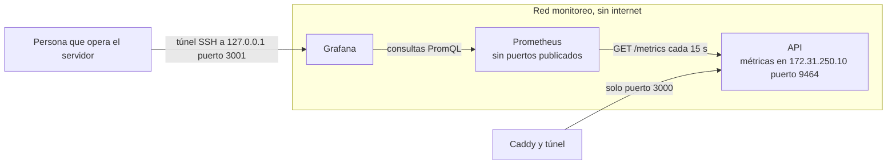

# Monitoreo con Prometheus y Grafana

La API publica métricas en formato de Prometheus. Prometheus las lee cada 15 segundos, las guarda 15 días y evalúa reglas de alerta. Grafana muestra un tablero con el tráfico, los tiempos de respuesta y los eventos de seguridad. Los tres corren en el mismo Docker Compose que la API.



## Qué se mide

| Métrica | Tipo | Etiquetas | Para qué |
|---|---|---|---|
| `fqs_peticiones_total` | contador | ruta, metodo, status | Tráfico y errores por ruta |
| `fqs_peticion_duracion_segundos` | histograma | ruta, metodo | Percentiles 50, 95 y 99 del tiempo de respuesta |
| `fqs_peticiones_en_curso` | medidor | ninguna | Carga en el momento |
| `fqs_limite_excedido_total` | contador | ruta | Respuestas 429 de los límites por ruta, por cuenta y de conexiones en tiempo real |
| `fqs_inicios_sesion_total` | contador | resultado | Correctos, contraseña equivocada, cuenta bloqueada, suspendida, desafío y códigos del segundo factor |
| `fqs_eventos_seguridad_total` | contador | accion | Cada evento que se escribe en la bitácora de seguridad (acceso denegado, fallos de administración, reuso de refresh token y los demás) |
| `fqs_bitacora_errores_total` | contador | ninguna | Eventos que no se pudieron escribir en la bitácora |
| `fqs_flujos_tiempo_real` | medidor | ninguna | Conexiones abiertas de cupos en tiempo real |
| `fqs_info` | info | version, entorno | Versión que está corriendo |
| `process_*`, `python_gc_*`, `python_info` | varios | ninguna | CPU, memoria, descriptores abiertos y tiempo encendida del proceso |

Las series que usan las alertas se crean en cero al arrancar. Sin eso, la primera vez que ocurre un evento la serie aparece ya con valor y `increase()` no lo cuenta.

## Cómo se protege

Las métricas dicen cuánto tráfico hay y cuántos ataques se están rechazando, así que también son información que un atacante querría ver. Por eso tienen las mismas reglas que el resto del sistema.

| Medida | Detalle |
|---|---|
| Puerto aparte | Las métricas salen en `METRICAS_PUERTO` (9464 en Docker), nunca en el puerto de la API. `GET /metrics` en la API responde 404 y la configuración se niega a arrancar si los dos puertos son iguales |
| Solo en la red de monitoreo | En Docker la API tiene una dirección fija en la red `monitoreo` y el servidor de métricas escucha solo en esa dirección. Caddy y el túnel comparten otra red con la API y no pueden alcanzar el puerto 9464 |
| Red sin internet | `monitoreo` es `internal`, ahí solo están la API, Prometheus y Grafana |
| Prometheus sin puertos publicados | Su interfaz y su API de consultas no tienen autenticación, por eso solo Grafana las alcanza por la red interna |
| Grafana solo en 127.0.0.1 | Se publica en `127.0.0.1:3001`. Desde otra computadora se entra con un túnel SSH, nunca abriendo el puerto en el firewall |
| Contraseña de Grafana en el entorno | `GRAFANA_ADMIN_PASSWORD` sale de `.env.docker`, que no se sube al repositorio. Compose no arranca si falta |
| Grafana endurecido | Sin registro de cuentas, sin acceso anónimo, sin snapshots ni tableros públicos, sin instalación de plugins, sin avisos de versiones ni estadísticas hacia Grafana Labs, cookie SameSite strict, CSP activada, sesión que vence a los 30 minutos sin uso y a las 12 horas, bloqueo por fuerza bruta (activo por omisión) |
| Configuración de solo lectura | El origen de datos y el tablero se cargan desde archivos montados como solo lectura y no se pueden editar ni borrar desde la interfaz |
| Contenedores | `read_only`, `cap_drop ALL` y `no-new-privileges` en Prometheus y Grafana, igual que en la API |
| Sin datos personales | La etiqueta de ruta es la plantilla (`/v1/actividades/{actividadId}`), nunca la dirección con ids. Una ruta inexistente se cuenta como `desconocida`, así nadie puede crear series nuevas mandando direcciones inventadas. No hay ids de usuario, IPs, correos ni tokens en ninguna métrica |
| Solo GET /metrics | El servidor de métricas responde 404 a cualquier otra ruta y 405 a cualquier otro método |

Si el rango `172.31.250.0/24` choca con otra red del servidor, se cambia en `docker-compose.yml` junto con `METRICAS_HOST` y la `ipv4_address` de la API.

## Alertas

Las reglas están en `docker/prometheus/alertas.yml` y se ven en Grafana, en Alerting, y en la página de alertas de Prometheus. Los avisos por correo de los eventos de seguridad los sigue mandando la API (ver [vigilancia-y-retencion.md](vigilancia-y-retencion.md)), así que no se agregó Alertmanager.

| Alerta | Condición | Severidad |
|---|---|---|
| `FqsApiCaida` | Prometheus no puede leer la API durante 1 minuto | crítica |
| `FqsErroresServidor` | Más del 5 por ciento de respuestas 5xx durante 5 minutos | alta |
| `FqsLatenciaAlta` | Percentil 95 arriba de 1 segundo durante 10 minutos, sin contar el flujo de cupos | media |
| `FqsMuchasRespuestas429` | Más de 50 respuestas 429 en una ruta en 10 minutos | media |
| `FqsInicioSesionFallidos` | Más de 30 inicios de sesión fallidos o bloqueados en 15 minutos | alta |
| `FqsAdministracionFallos` | Más de 5 contraseñas o códigos equivocados en cuentas de administración en 15 minutos | crítica |
| `FqsAccesosDenegados` | Más de 10 accesos denegados a rutas de administración en 15 minutos | alta |
| `FqsRefreshReutilizado` | Cualquier reuso de un refresh token ya rotado | alta |
| `FqsBitacoraSinEscribir` | Cualquier evento de seguridad que no se pudo guardar | crítica |

Los umbrales están pensados para el piloto y se ajustan con el uso real. Las reglas tienen pruebas en `docker/prometheus/alertas_pruebas.yml`.

```bash
promtool check config docker/prometheus/prometheus.yml
promtool test rules docker/prometheus/alertas_pruebas.yml
```

## Tablero

Grafana carga el tablero "Familias que Suman, API" en la carpeta del mismo nombre. Tiene cuatro secciones.

| Sección | Paneles |
|---|---|
| Estado general | API arriba, tiempo encendida, peticiones por segundo, errores 5xx, conexiones en tiempo real, memoria |
| Tráfico y tiempos | Peticiones por código, percentiles 50, 95 y 99, rutas con más tráfico, respuestas 4xx y 5xx por ruta |
| Seguridad | Respuestas 429 por ruta, inicios de sesión por resultado, eventos de la bitácora, fallos de administración, accesos denegados, tokens reutilizados, errores al escribir la bitácora, alertas activas |
| Proceso | CPU, memoria residente, peticiones en curso y descriptores abiertos |

## Puesta en marcha

Prometheus y Grafana arrancan con el resto del sistema. Solo hace falta poner la contraseña de Grafana en `.env.docker`.

```bash
# en .env.docker
GRAFANA_ADMIN_PASSWORD=una-contraseña-larga-y-distinta
docker compose --env-file .env.docker up -d --build
```

En el mismo servidor se abre http://127.0.0.1:3001 y se entra con `GRAFANA_ADMIN_USER` (admin por omisión) y esa contraseña. Desde otra computadora se abre un túnel SSH y luego la misma dirección en el navegador local.

```bash
ssh -L 3001:127.0.0.1:3001 usuario@servidor
```

Para ver las métricas en crudo desde el servidor sin exponerlas.

```bash
docker compose --env-file .env.docker exec prometheus wget -qO- http://api:9464/metrics | head
```

## Sin Docker

1. En `.env` de la API se pone `METRICAS_PUERTO=9464` y se deja `METRICAS_HOST=127.0.0.1`.
2. Prometheus se instala en el mismo servidor con `docker/prometheus/prometheus.yml`, cambiando el destino `api:9464` por `127.0.0.1:9464` y la ruta de `alertas.yml`.
3. Grafana se instala en el mismo servidor, escuchando en 127.0.0.1, con los archivos de `docker/grafana/provisioning` y `docker/grafana/tableros`.

## Pruebas

| Prueba | Resultado |
|---|---|
| `tests/test_09_metricas.py` (10 pruebas) | Puerto de la API sin métricas, solo GET /metrics, plantilla de ruta sin ids, sin datos personales, inicios de sesión, eventos de seguridad, respuestas 429, conexiones en tiempo real, series en cero desde el arranque y puerto distinto obligatorio |
| `promtool check config` y `check rules` con Prometheus 3.15.0 | Configuración válida, 9 reglas |
| `promtool test rules` | Las 5 situaciones de prueba disparan exactamente las alertas esperadas |
| Prometheus 3.15.0 leyendo la API real con tráfico de prueba | Destino arriba, las 24 consultas del tablero responden sin error, `FqsAdministracionFallos` se disparó con 7 intentos de contraseña equivocada contra la cuenta de administración y `FqsApiCaida` al detener la API |

La salida está en [evidencia/monitoreo.txt](evidencia/monitoreo.txt).
